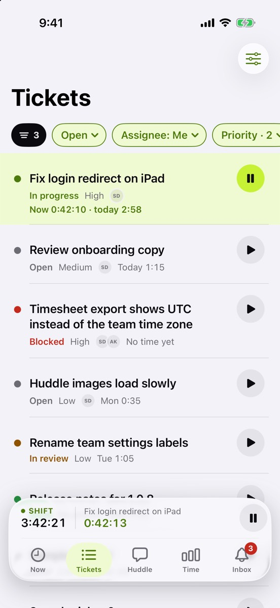
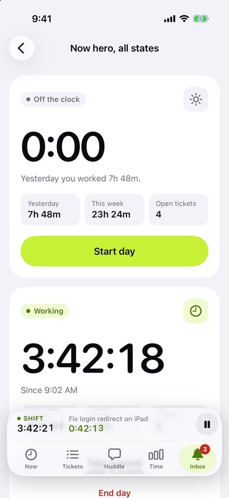
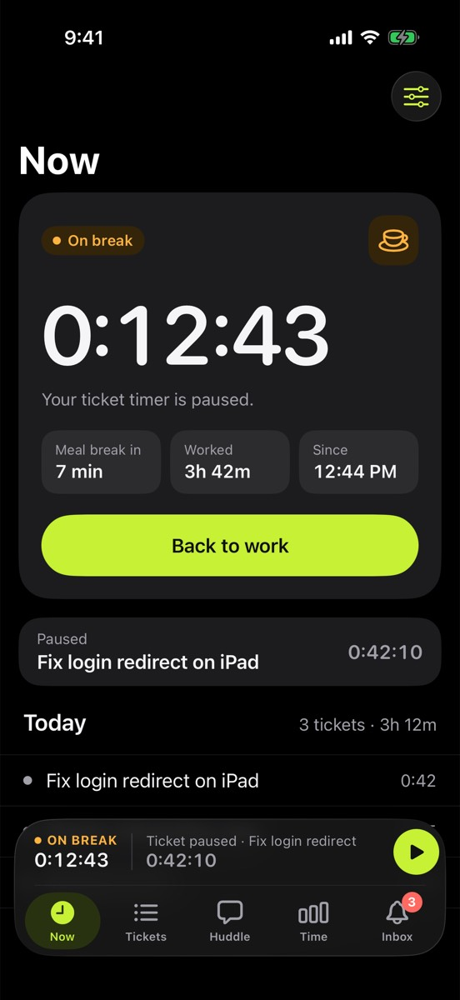

The first build is all about how Huddle looks and feels. Nothing talks to a server yet: this is the design system every later screen is built from.

## What’s new

- **One glass dock** holds the five tabs and, while you’re on the clock, a strip with your shift and ticket timers. It’s on every tab, so your time is always one glance away.
- **The Now hero** has one clear state at a time: off the clock, working, on a break or done for the day, each with a single main button.
- **Lime for working, amber for breaks.** The colors mean the same thing everywhere.
- **Light and dark**, following your phone’s setting.

## Try it

- Switch your phone between light and dark mode and look around.
- Turn on Settings › Accessibility › Display & Text Size › Reduce Transparency: the glass turns solid and stays readable.
