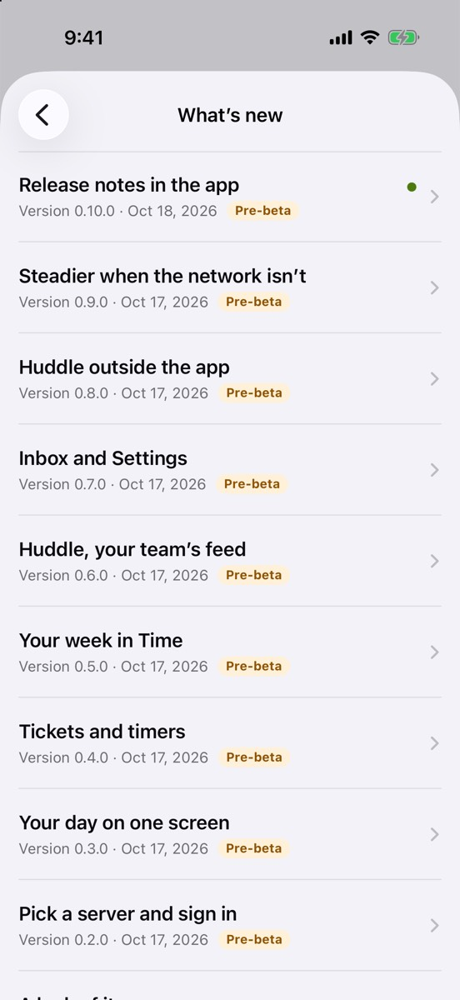
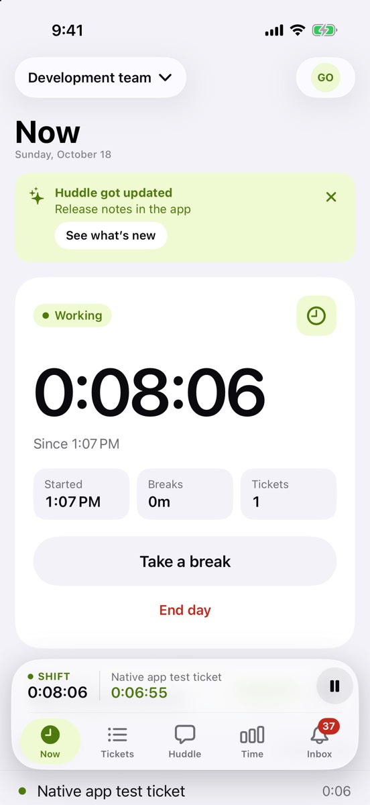

You’re reading it. Each pre-beta build now explains what changed and how to try it.

## What’s new

- **“Huddle got updated”** shows on Now once after an update. Tap See what’s new, or close it.
- **Settings › What’s new** lists every build’s notes, newest first, with a dot on the ones you haven’t seen.
- **Screenshots and short clips** show each feature. Clips play muted and loop. With Reduce Motion on they start paused; tap one to play or pause it.

## Try it

- Open Settings › What’s new and read the notes for builds you skipped.
