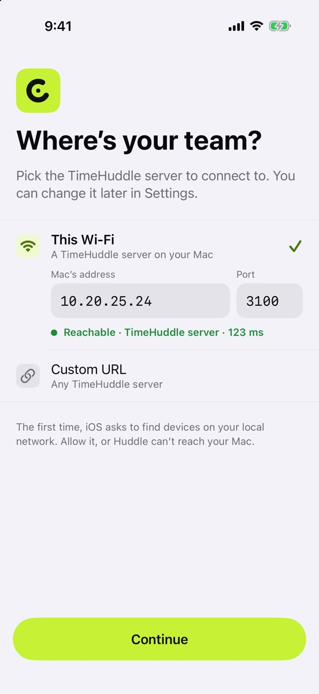
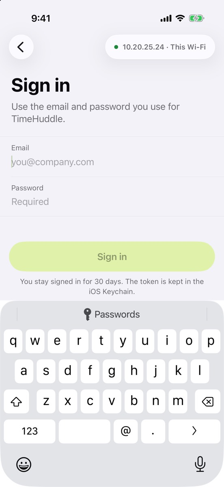

Huddle can now reach a TimeHuddle server and sign you in with the account you already use on the web.

## What’s new

- **Choose where your TimeHuddle lives:** This Wi‑Fi, Development, Production or a custom address.
- **The connection test runs as you type**, so you know the address works before you sign in. It says how fast the server answered, or why it couldn’t reach it.
- **Sign in with your email and password.** A wrong password, a suspended account or a required reset each get their own plain message.
- **Huddle remembers your team**, and the team name at the top of the screen switches between teams.

## Try it

- The first time, iOS asks to find devices on your local network. Allow it, or a server on your Wi‑Fi can’t be reached.
- Close the app completely and open it again: you stay signed in, on the same team.
