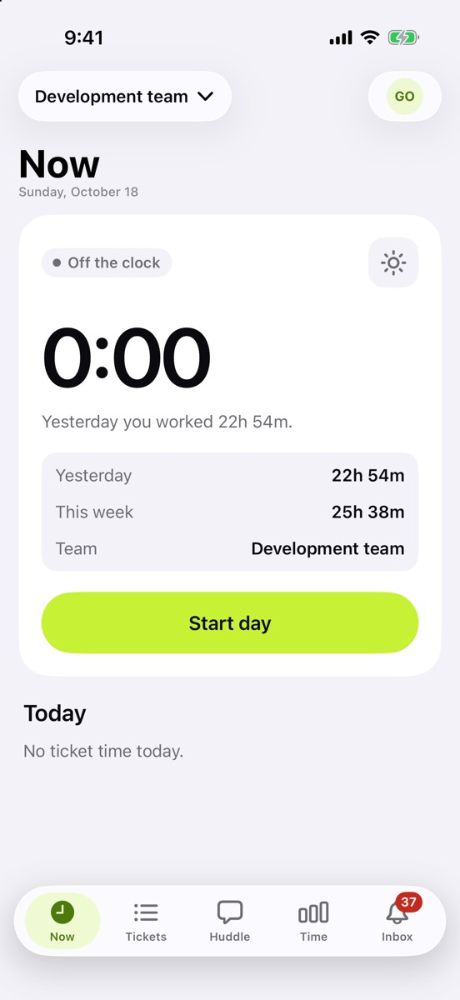
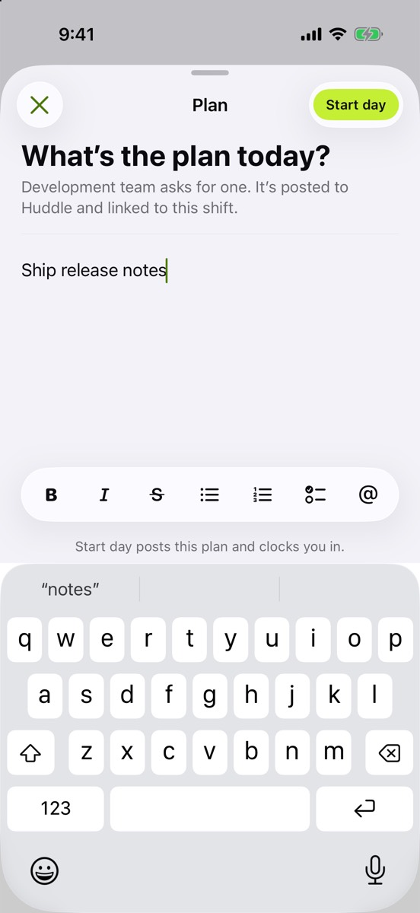
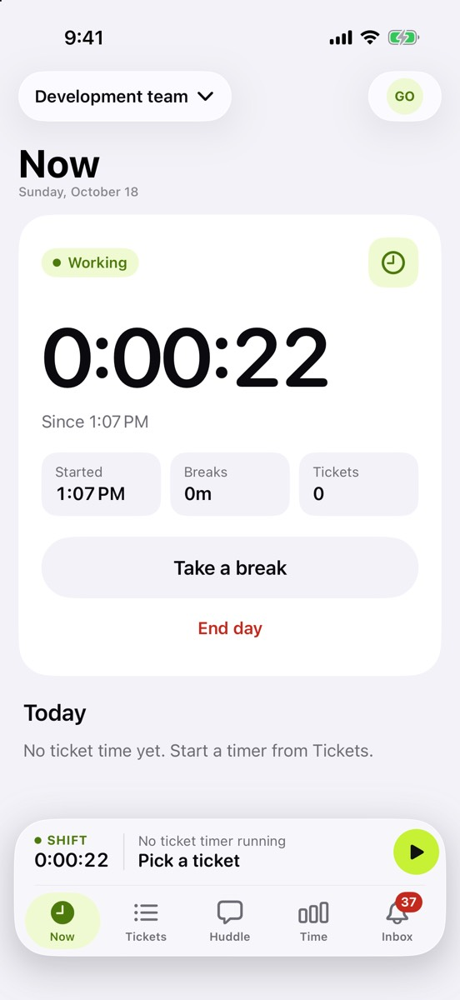

Now is where your day starts and ends. One button does the next thing, whatever state you’re in.

## What’s new

- **Start day, Take a break, Back to work, End day.** One main button each time, and it changes the server straight away.
- **A live shift timer** that keeps ticking even when the connection is slow, plus a note when a break is about to count as a meal break.
- **Plans and wrap-ups.** If your team asks for a plan, Start day opens a short plan sheet first. It’s posted to Huddle and linked to your shift. End day does the same with a wrap-up.
- **Today’s work:** the ticket you’re timing, and how long each ticket took today.

## Try it

- Start your day, take a break, come back, and end the day. Then check the same shift in the web app: the times should match.
