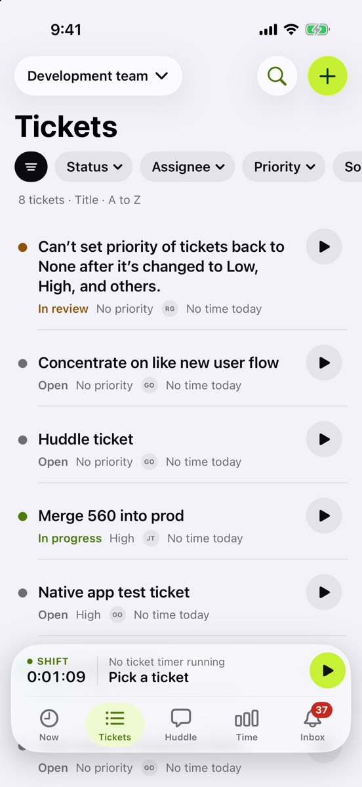
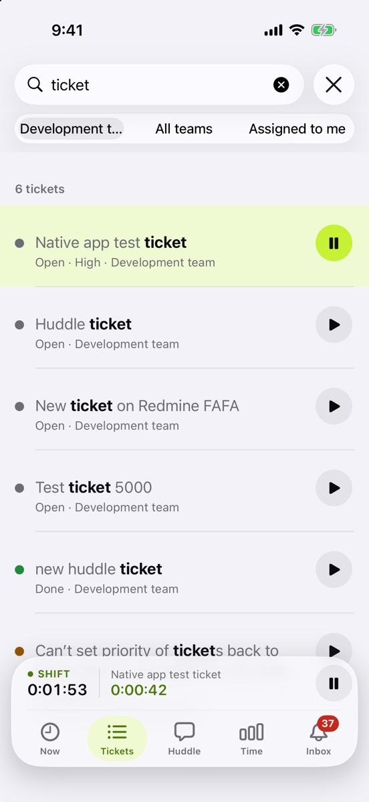

Your team’s tickets, and a timer on each one.

## What’s new

- **An edge-to-edge list** with pills for status, assignee, priority and sort. The default shows open tickets.
- **Tap play to time a ticket.** Only one timer runs at a time, so starting another stops the first. If you’re off the clock, Huddle offers “Start day & timer” to do both.
- **Swipe a ticket** to move it along: in progress, done, or reopen.
- **Search** sits behind the magnifying glass. It searches this team, all your teams or only tickets assigned to you, and remembers recent searches.
- **New ticket** with a title, details, priority, assignees and a GitHub link. You can start its timer right away.

## Try it

- Start a timer on one ticket, then on another. The first one should stop.
