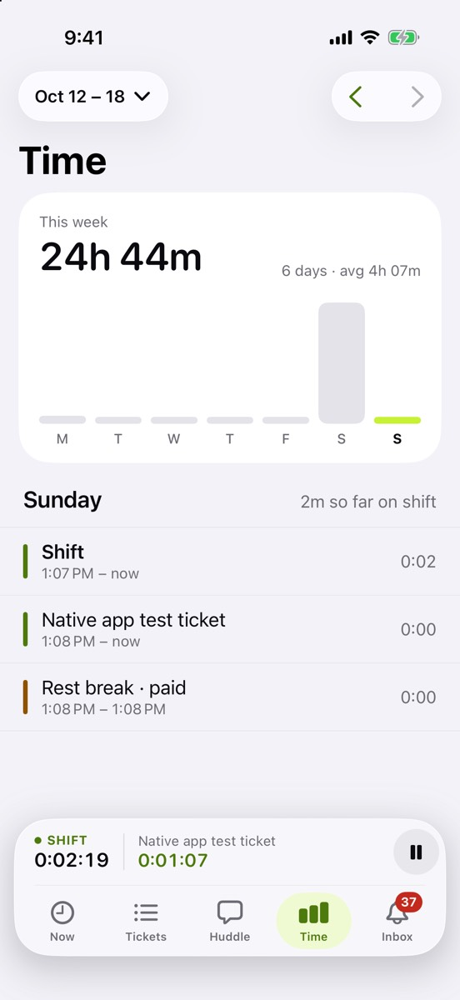

The Time tab shows where your hours went.

## What’s new

- **This week’s total** and a bar for each day. Tap a day to see it.
- **Day detail:** each shift that started that day, then its ticket timers and breaks, newest first.
- **Go back a week** with the arrows at the top.

## Try it

- Compare this week’s total with the web app’s timesheet. They should match to the minute.
