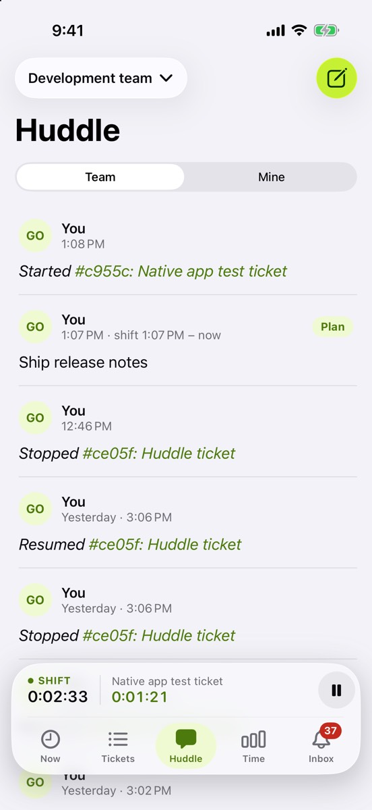
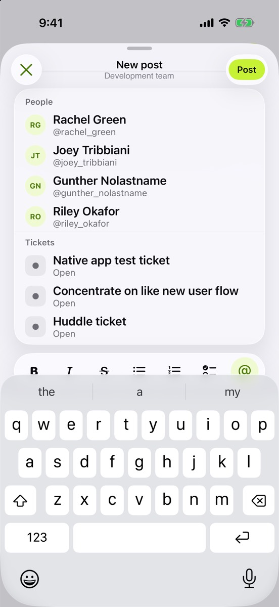

See what your team is working on, and post your own updates.

## What’s new

- **The team feed**, with Team and Mine. Plans and wrap-ups have a badge, and pictures and ticket links show in the post.
- **A rich composer:** bold, italic, strikethrough, bullet and numbered lists, and checklists you can tick.
- **Type @ to mention** a teammate or a ticket. Posts look the same in the web app.
- The feed refreshes every 30 seconds while you’re on it, or pull down to refresh.

## Try it

- Post something with a checklist and a mention, then open the web app: it should look the same there.
