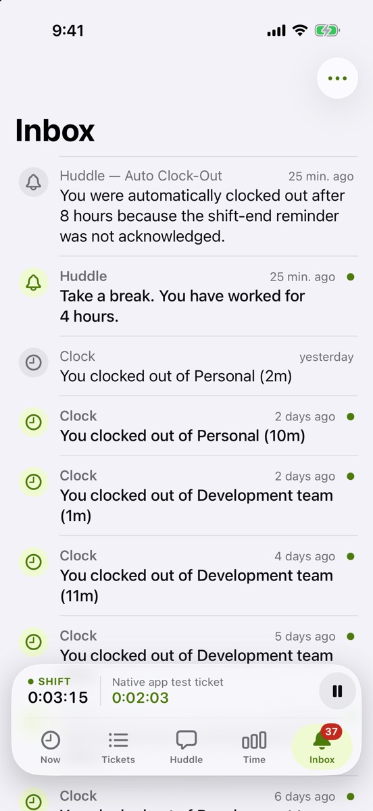
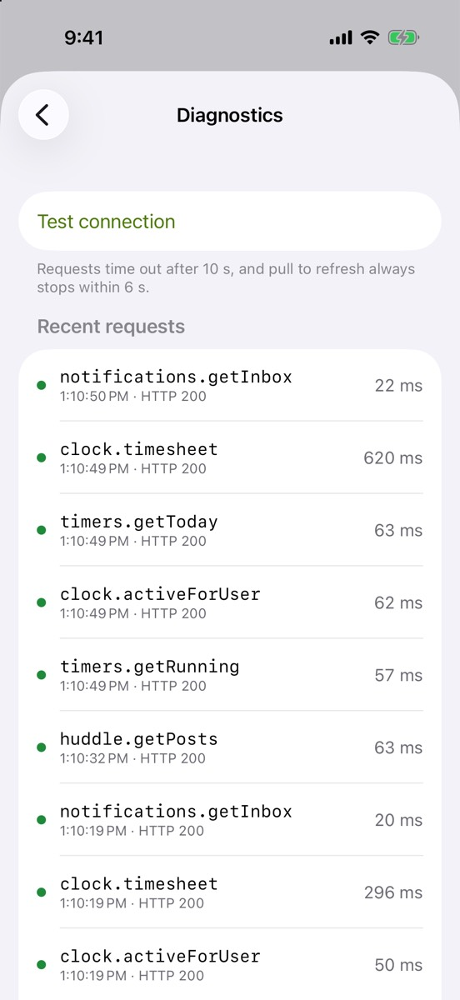

Your notifications have a home, and Settings has the details you need when something seems off.

## What’s new

- **Inbox** lists clock, shift reminder, ticket and mention notifications. The tab shows how many are unread.
- **Tap a notification** to mark it read and jump to what it’s about, switching team if needed.
- **Swipe right to mark read, left to delete.** The ••• menu has Mark all read and Delete read.
- **Settings** opens from your avatar on Now: your profile, team, server, version and Sign out.
- **Diagnostics** in Settings lists the last requests to the server and how long each took, plus a Test connection button.

## Try it

- If something feels slow, open Settings › Diagnostics and send us a screenshot.
