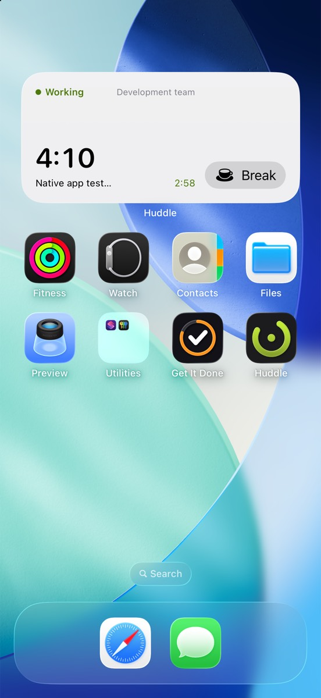
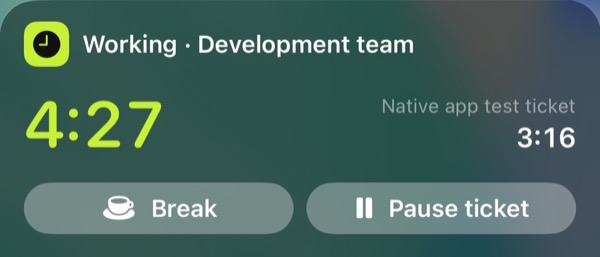
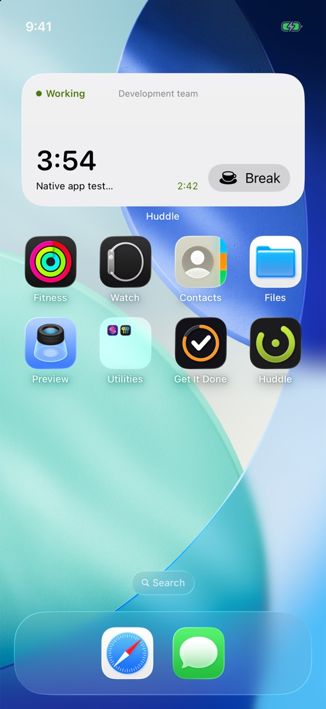
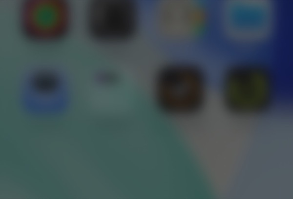

Check your time and take a break without opening Huddle.

## What’s new

- **A Live Activity** on the Lock Screen and in the Dynamic Island while you’re on the clock: shift time, the ticket you’re timing, and Break, Back to work and Pause ticket buttons.
- **Widgets** for the Home Screen and Lock Screen, in every size. The medium one has a Break / Back button.
- **Control Center controls:** a Shift toggle and a Break button.
- **Siri and Shortcuts:** start or end the day, take a break, and start or pause a ticket timer.
- If your team asks for a plan or a wrap-up, starting or ending the day from outside the app sends you a notification. Tap it to open the right sheet.

## Try it

- Add the controls: open Control Center, tap +, then Add a Control and search for Huddle.
- Start a break from the Lock Screen, then check Now: it should already show you on a break.
