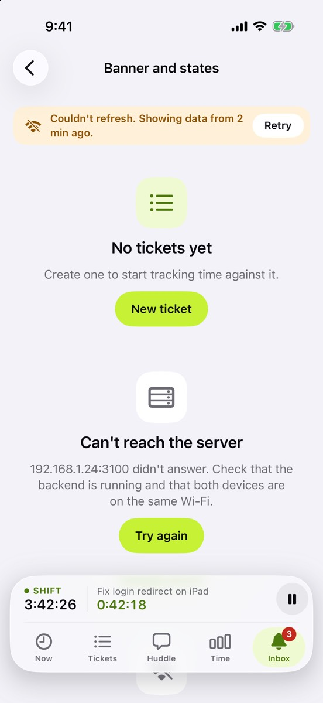
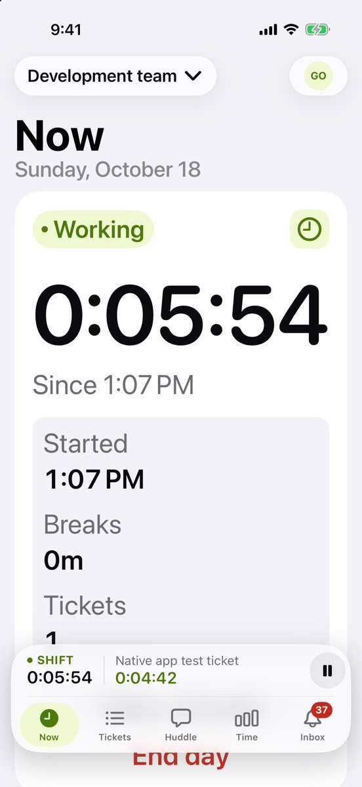

This build is about trust: Huddle should never spin forever, and should work for everyone.

## What’s new

- **Pull to refresh always stops within 6 seconds.** If the server is slow or gone, you keep the data you had, with a banner saying how old it is and a Retry button.
- **Faster cold start:** your teams and profile show straight away, even before the server answers.
- **Large text works everywhere.** Every screen was checked at the largest accessibility size, and layouts stack instead of cutting text off.
- **VoiceOver labels** on every icon button, **Reduce Motion** respected, and nothing hides behind the dock.

## Try it

- Turn on Airplane Mode and pull to refresh on any tab. The spinner should stop quickly and your data should stay.
- Turn your text size all the way up and look for anything cut off.
